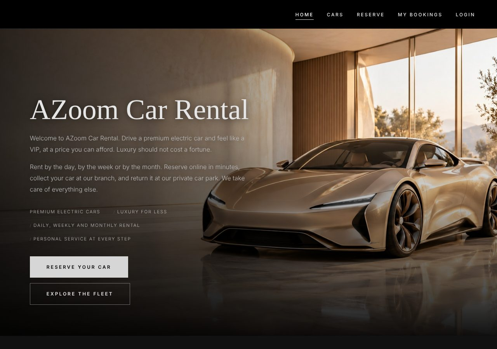

# AZoom Car Rental

A front-end website for **AZoom Car Rental**, a fictional company that rents premium electric cars by the day, week or month.
Built with plain **HTML, CSS and JavaScript** — no frameworks and no back-end.



## Features

The site covers the full rental journey, for both customers and staff:

| Step | Page | What happens |
|---|---|---|
| 1. Reserve | `reserve.html` | Choose a car, branch, dates and daily / weekly / monthly rental. The price updates live. Pay by credit card (number, expiry and CVV are checked). |
| 2. Pick up | `bookings.html` | The customer collects the car at the branch office. |
| 3. Return | `bookings.html` | The customer returns the car to a chosen car park and parking bay. |
| 4. Inspect | `staff.html` | Staff tick any damage, battery level and late days. Extra charges are added up automatically. |
| 5. Final bill | `bookings.html` | The customer sees the itemised bill (rental + damage − deposit) and pays. |

Other pages:
- `index.html` — landing page with the fleet, the 5 steps and the two branches
- `cars.html` — car list built from a JavaScript array, with filters (type, branch) and price sorting
- `login.html` — customer / staff login and sign-up

## How it works

- **Data:** cars, users and sample bookings are stored in JavaScript arrays of objects (`js/data.js`).
- **State:** new bookings and status changes are saved in the browser with `localStorage`, so a booking made on one page shows on the others.
- **Rendering:** cards and tables are created with template strings and `innerHTML`; buttons use event listeners.
- **Design:** dark showroom theme, CSS variables for colours, Flexbox and Grid layouts, CSS animations, and responsive layouts for tablet and mobile.

## Try it

Open `index.html` in a browser, or use the live site (link coming soon).

Demo accounts:

| Role | Email | Password |
|---|---|---|
| Customer | customer@azoom.com | 1234 |
| Staff | staff@azoom.com | 1234 |

To reset the demo data, clear the site's Local Storage in your browser's developer tools.

## Project structure

```
├── index.html      Home
├── cars.html       Car list
├── reserve.html    Reservation and payment
├── bookings.html   My bookings (pick up, return, pay)
├── login.html      Login and sign up
├── staff.html      Staff portal (hand over, inspect, bill)
├── css/style.css   All styles
├── js/             One script per page + shared data.js
└── images/         Car and branch photos
```

## Notes

- Made for **ISIT207 Frontend Web Programming** (University of Wollongong, Assignment 2).
- All car designs, names, addresses and phone numbers are fictional.
- Developed with AI assistance (Claude). Images were created with AI tools.
